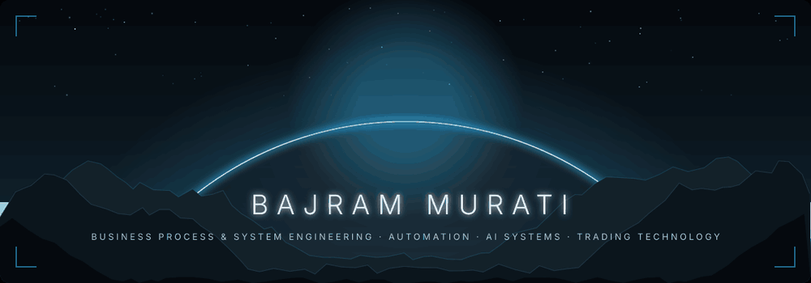

  

  <b>Business Process &amp; System Engineer</b> · CEO of the4ce GmbH 
  I connect business processes with the systems behind them: ERP, workflow automation and AI. 
  Strong in <b>Python</b> and in designing <b>AI system architectures</b>. Future-oriented: I build for what comes next.

  
    
  
  

 

  

